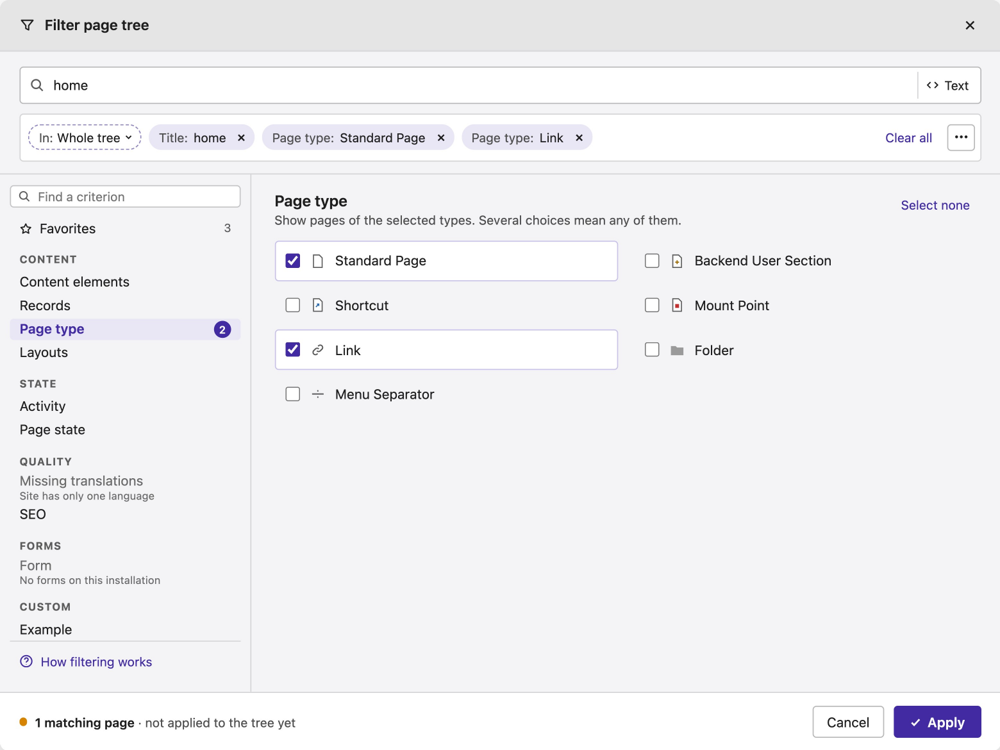
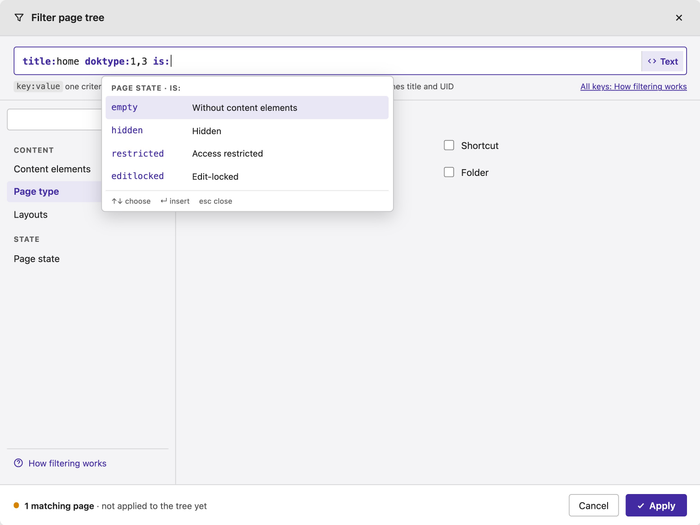
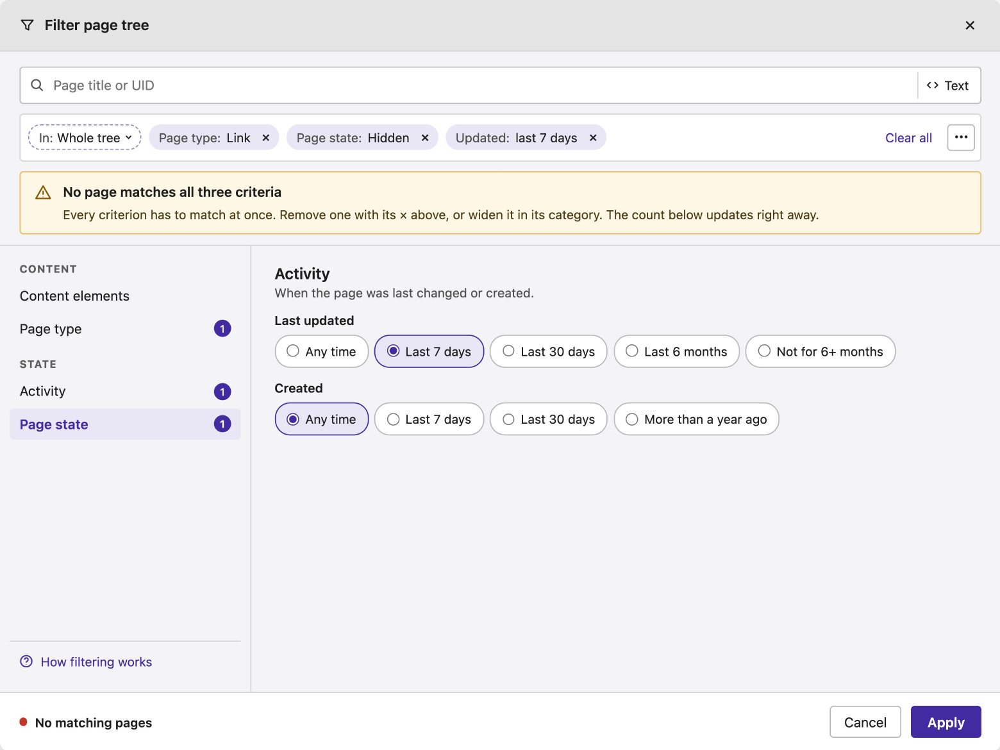
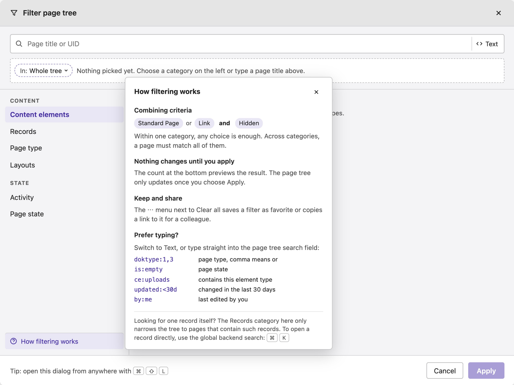
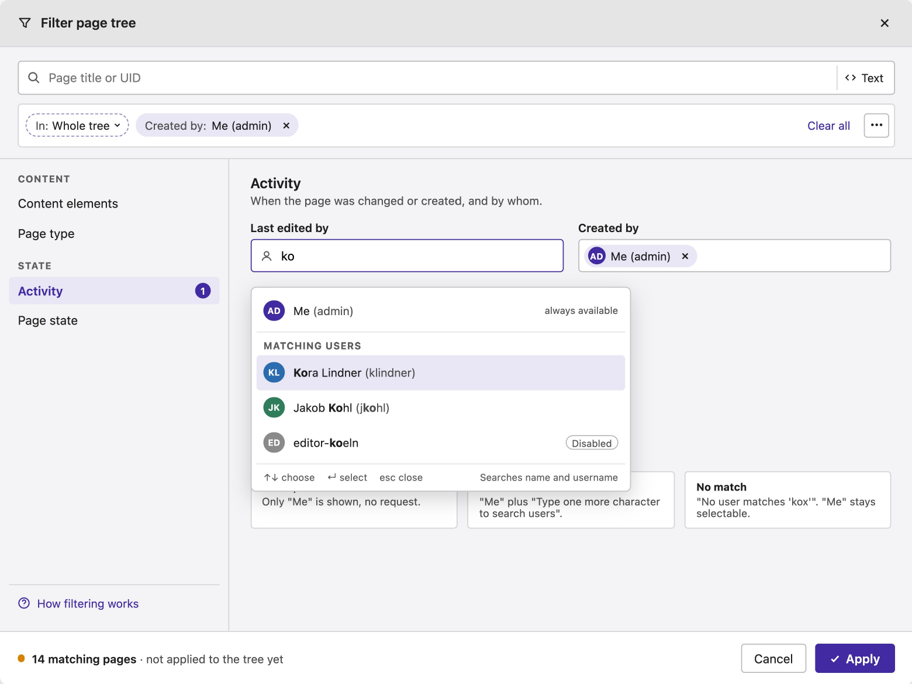
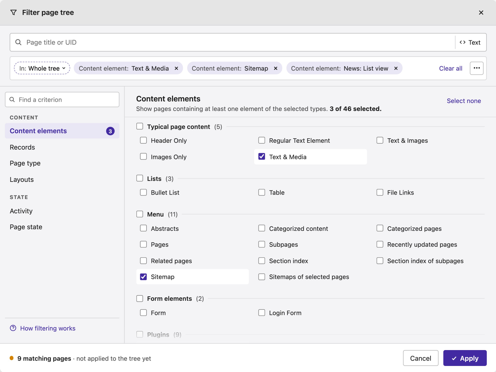
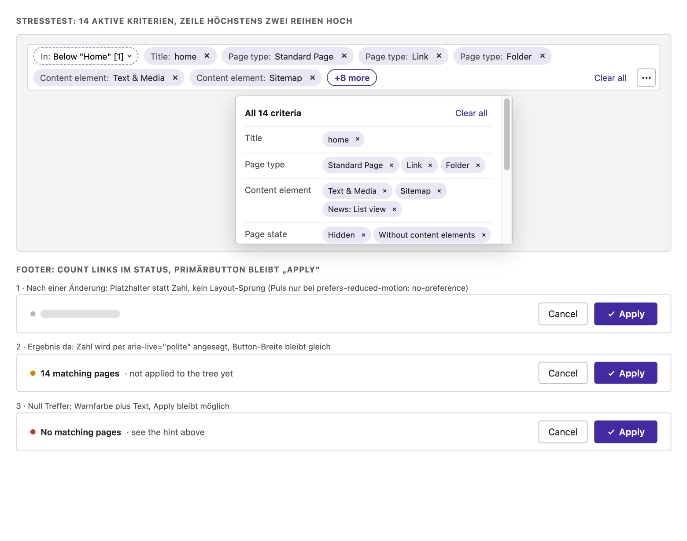
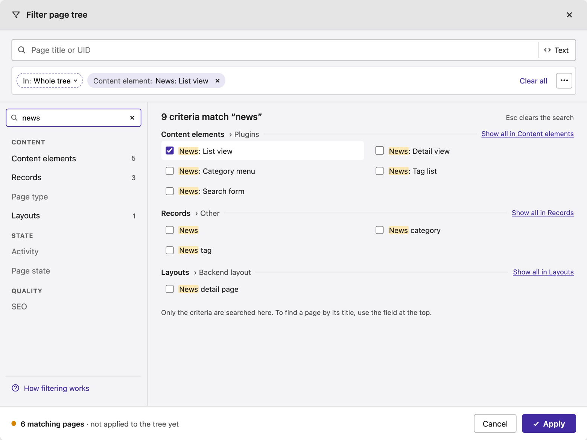
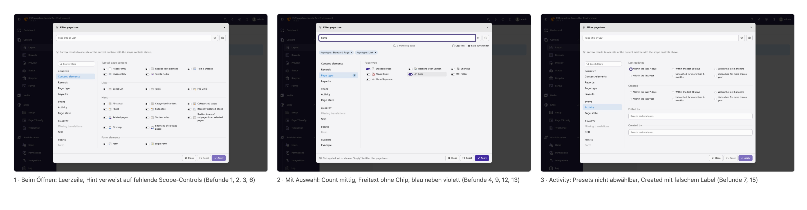
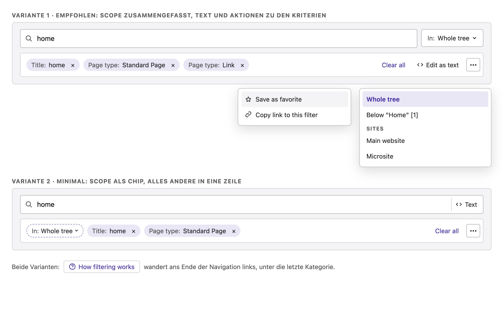

# Screen designs

The reference designs for the filter modal. They live on a design canvas: https://claude.ai/artifact/D5CAJaRRpGEAMhJgwYciwx. The canvas is private to its owner until it is shared from its Share menu.

The boards **A** to **H** are the target. The row **Ist-Zustand** records the audit of TYPO3 14.3 that led to these rules, the board **Werkzeugzeile entschlackt** compares two toolbar variants, of which variant 2 was chosen and is drawn into A to H.

Board titles, notes and the audit are German, the mockups use English copy. Counts, user names and third-party element types in the mockups are examples.

The rules behind these screens are in [rules.md](rules.md). The previews are exports of the canvas; click one for the full size. When a board changes on the canvas, export it again and replace its file in `screens/`.

## Boards

| Board | Screen | What it settles | Preview |
| --- | --- | --- | --- |
| A | Form view | Search field with the Text switch, criteria row with scope chip, one chip per value, Clear all and the actions menu, checkboxes, panel heading with description and Select none, disabled categories with a reason, help link pinned to the end of the navigation, live count in the footer |  |
| B | Edit as text | The same field holding the whole phrase, syntax highlighting, the short reference in place of the criteria row, key and value suggestions, form still in sync |  |
| C | No matching pages | Warning callout before Apply that points at the chips, Any time as the first preset, red status with words |  |
| D | Empty state and help | Fixed empty state in the criteria row, help popover next to the navigation, shortcut in the footer while nothing is picked |  |
| E | User autocomplete | Me pinned, two characters before a request, highlighted matches, disabled accounts marked, the picked user as a chip in the field |  |
| F | 46 content element types | Sticky panel heading with `3 of 46 selected`, sticky group headings, group checkbox, dense three-column rows |  |
| G | Many criteria and footer states | Two rows of chips at most, then `+N more` with a popover of all criteria; counting, result and no-result states of the footer |  |
| H | Criterion search results | Matches grouped by category and field, highlighted, hits per category in the navigation, Show all in, Esc clears |  |

## Reference

| Board | Screen | What it settles | Preview |
| --- | --- | --- | --- |
| Ist-Zustand | Audit of TYPO3 14.3 | Opening state, selection and Activity tab of the current modal, numbered findings |  |
| Werkzeugzeile | Toolbar variants | Variant 1 and 2 side by side; variant 2 is the one drawn into A to H |  |
